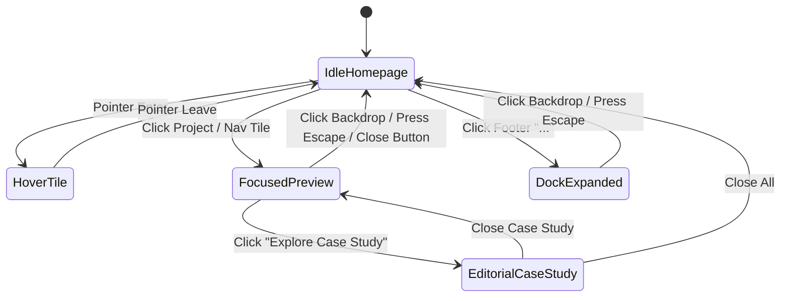

# Portfolio Implementation Plan: Manav's Personal Portfolio

**Target Repository**: `https://github.com/manav-chaudhary01/portfolio.git`  
**Working Directory**: `c:\Users\Acer\Desktop\manav-portfolio`  
**Date**: November 2026  
**Status**: Milestone 1 — Implementation & Architecture Blueprint  

---

## 1. Technical Architecture & Stack Evaluation

### 1.1 Core Stack Selection
Based on the visual requirements, tactile spring physics, lightweight bundle targets, and developer ecosystem, the following stack is recommended:

| Layer | Recommended Choice | Rationale & Trade-offs |
|---|---|---|
| **Framework & Build** | **React 19 + TypeScript + Vite 6** | Ultra-fast HMR, strict type safety, zero bundler bloat, modern ES modules, perfect synergy with the existing Node.js v24 environment. |
| **Animation Engine** | **Motion for React (`motion` / `framer-motion`)** | Standard-bearer for layout animations (`layoutId`), tactile spring physics, orchestrated exit/enter transitions, reduced-motion hooks (`useReducedMotion`), and gesture handling (`whileHover`, `whileTap`). |
| **Styling & Design Tokens** | **Tailwind CSS v4 (or Tailwind v3.4) + Custom CSS Variables** | Rapid utility composition, zero-runtime overhead, fluid typography, native container queries, and seamless custom theme tokens for warm paper colors and dotted canvas. |
| **Iconography** | **`lucide-react`** | Consistent, tree-shakeable stroke icons with accessible SVG attributes, ideal for dock buttons, badges, and action triggers. |
| **Visual Illustrations** | **Custom Handcrafted Vector SVGs & CSS 3D Transforms** | Clean, ultra-sharp rendering on all screens, zero heavy 3D canvas runtime overhead (compared to Three.js or Spline which would add 500kb+ and battery drain), fully scriptable with CSS and Motion. |
| **Testing & Quality** | **Vitest + React Testing Library + `@axe-core/react` + Playwright** | Fast unit and component interaction testing, accessibility compliance scanning, and visual regression / end-to-end sanity verification. |

---

## 2. Component Hierarchy & System Architecture

```
src/
├── app/
│   ├── App.tsx                     # Main layout orchestrator & state container
│   ├── main.tsx                    # React DOM entry point
│   └── index.css                   # Global reset, typography, and canvas dot grid
├── components/
│   ├── canvas/
│   │   ├── DottedBackground.tsx    # Responsive SVG/CSS dot pattern canvas
│   │   └── HandwrittenGreeting.tsx # Warm, tilted handwritten greeting
│   ├── navigation/
│   │   ├── NavigationIsland.tsx    # Centered container for interactive nodes
│   │   ├── NavTile.tsx             # Tactile 3D/illustrated node with spring physics
│   │   └── PillLabel.tsx           # Rounded micro-label with hover state
│   ├── previews/
│   │   ├── PreviewBackdrop.tsx     # Soft blur & dimming layer (Pixelwrld effect)
│   │   ├── ProjectPreviewCard.tsx  # Expanding showcase card with tilted mockups
│   │   └── PreviewActions.tsx      # Case study trigger & external links
│   ├── editorial/
│   │   ├── EditorialDrawer.tsx     # Full-depth Portal-style project deep-dive
│   │   ├── FeatureGrid.tsx         # Circular badge feature list
│   │   ├── ArchitectureTable.tsx   # Verified technology breakdown table
│   │   └── HandwrittenCallout.tsx  # Playful blue script annotations with arrows
│   ├── playground/
│   │   ├── PlaygroundModal.tsx     # Interactive micro-toys & creative experiments
│   │   └── InteractiveOrbs.tsx     # Lightweight canvas physics / generative widget
│   ├── about/
│   │   └── AboutModal.tsx          # Personal story, design values, and background
│   └── footer/
│       ├── SocialDock.tsx          # Floating expandable bottom dock
│       └── DockIconButton.tsx      # Tactile circular action button
├── data/
│   ├── projects.ts                 # Strictly verified project catalog & metadata
│   ├── about.ts                    # Bio, engineering philosophy, and stack details
│   └── socialLinks.ts              # Contact endpoints (Email, GitHub, LinkedIn, Résumé)
├── hooks/
│   ├── useReducedMotion.ts         # Accessibility motion preference detection
│   ├── useKeyboardNavigation.ts    # Escape to close, arrow key focus trapping
│   └── useScrollLock.ts            # Disables body scrolling during modal/drawer states
└── types/
    └── index.ts                    # Shared TypeScript interfaces & types
```

---

## 3. State Management & Interaction Orchestration

The application state is lean and intentionally decentralized:



### Key Interaction Details:
1. **Active Focus (`activeId: string | null`)**:
   - When `activeId` is null, all four tiles sit in standard tactile floating state.
   - When `activeId` is active, siblings receive `opacity: 0.15, filter: blur(8px)`, while the active item scales smoothly into its preview position using Motion's shared `layoutId`.
2. **Backdrop Blur & Focus Isolation**:
   - Implemented via a fixed-position container with `backdrop-filter: blur(12px) bg-white/40` and spring enter/exit transitions.
3. **Keyboard Accessibility**:
   - Pressing `Escape` at any depth restores the previous layer.
   - Full keyboard focus rings appear only on `:focus-visible` to keep mouse interactions pristine.

---

## 4. Phase-by-Phase Development Plan

### Phase 1: Planning, Design Brief & Documentation Milestone (Current)
- [x] Inspect all reference screenshots in `references/`.
- [x] Audit existing repository, Node.js (`v24.13.0`), npm (`11.6.2`), and Git (`2.53.0`).
- [x] Initialize Git on `main` branch connected to `https://github.com/manav-chaudhary01/portfolio.git`.
- [x] Produce `docs/portfolio-design-brief.md` detailing the visual and interaction system.
- [x] Produce `docs/implementation-plan.md` defining technical architecture and roadmap.
- [ ] Stage, commit, and push Phase 1 documentation milestone to GitHub.

### Phase 2: Project Scaffolding & Design Foundation
- Initialize Vite React + TypeScript template in root directory.
- Configure Tailwind CSS with custom design tokens (warm canvas `#FAF8F5`, dotted grid pattern, neutral palette, typography scales).
- Set up font loaders for editorial serif (`Instrument Serif` or `Newsreader`), modern sans (`Plus Jakarta Sans`), and handwritten script (`Caveat`).
- Build responsive `DottedBackground` component and basic layout container.
- Verification: Run `npm run build` and ensure clean compile with zero lint/type errors.

### Phase 3: Homepage Composition & Tactile Navigation Island
- Create `HandwrittenGreeting` component with authentic tilted script styling.
- Author handcrafted 3D/illustrated vector components for the 4 navigation nodes:
  1. **Work / Projects**
  2. **About**
  3. **Playground**
  4. **Contact**
- Implement `NavTile` with Motion spring physics: hover lift (`y: -8px`), subtle rotation (`rotate: ±1.5deg`), dynamic shadow bloom, and rounded pill labels (`#F2EFE9`).
- Implement the centered intro bio copy with balanced leading.
- Verification: Test hover feedback, keyboard tab navigation, and mobile touch response.

### Phase 4: Expanding Project Previews (Pixelwrld Focus Interaction)
- Implement `PreviewBackdrop` with soft blur (`backdrop-filter: blur(12px)`) and dimming of non-selected elements.
- Build expanding `ProjectPreviewCard` using Motion layout animations:
  - Angled/tilted multi-layer card mockups.
  - Editorial project title and verified value proposition.
  - Verified technology badges.
  - Action buttons: "View Case Study" and "Source Code / Live Demo".
- Implement smooth dismiss mechanics (backdrop click, escape key, close button).
- Verification: Verify smooth 60fps layout animations and verify that closing restores homepage state without layout shift.

### Phase 5: Editorial Project Showcase (Portal Deep-Dive Experience)
- Implement `EditorialDrawer` for deep-dive exploration of Manav's verified projects:
  - **Meter Flow**: Architecture breakdown (Node 24, Express 5, Mongo 9, Decimal.js, 163 tests), multi-tenant isolation, linear spend forecasting, feature badges.
  - **Attendance Tracker**: Offline-first design, IndexedDB synchronization, threshold calculations, React 19 architecture.
  - **LeetCode Desktop Widget**: Wallpaper-layer Windows integration, .NET 10 WPF architecture, Explorer resilience, 53-week heatmap.
- Create Portal-style feature list with circular category badges.
- Add handwritten blue annotation callouts with directional SVG arrows.
- Verification: Review all project descriptions against the source code repositories to ensure 100% accuracy.

### Phase 6: About Modal, Interactive Playground & Expandable Social Dock
- Implement `AboutModal` sharing Manav's background, engineering philosophy, and craft values.
- Implement `PlaygroundModal` with a creative micro-interaction (e.g. interactive tactile physics / canvas experiment).
- Implement `SocialDock` (`...` bottom pill) that smoothly expands into an elevated dock with circular buttons for Email, GitHub, LinkedIn, and Résumé.
- Verification: Validate all outbound links and contact triggers.

### Phase 7: Polish, Accessibility Audit, Responsive Testing & Final Delivery
- Execute accessibility audit with `@axe-core` and keyboard-only test walkthrough.
- Verify `prefers-reduced-motion: reduce` across all animated components.
- Responsive validation across Mobile (375px, 414px), Tablet (768px, 820px), and Desktop (1280px, 1920px).
- Production build validation (`npm run build`).
- Final milestone commit and push to GitHub.

---

## 5. Verification & Testing Strategy

To guarantee the highest standard of craft and stability, every phase must satisfy:
1. **Type Safety**: `npm run build` (running `tsc -b && vite build`) must pass with zero errors.
2. **Visual Consistency**: Compare renders against reference screenshots (`references/`) in both light theme and across responsive breakpoints.
3. **Interaction Reliability**: Focus state transitions, modal opening/closing, and dock expansion must be tested on both mouse pointer and keyboard (`Tab`, `Enter`, `Escape`).
4. **Accuracy Verification**: No technical terms or achievements will be present unless backed by the verified project files.
5. **Git Hygiene**: Strict adherence to the conventional commit policy and immediate verification of remote push.

---

## 6. Key Design Decisions for User Review & Alignment

Before proceeding with Phase 2 implementation, the following key design decisions are surfaced for your feedback:

1. **Navigation Object Styling**:
   - *Option A (Recommended)*: Handcrafted, multi-layered SVG illustrations styled with CSS 3D perspectives, soft gradients, and ambient drop shadows. Provides zero bundle overhead, crisp vector fidelity on all screens, and instant 60fps spring animations.
   - *Option B*: 3D Canvas / Spline / Three.js interactive models. Offers true 3D orbital rotation, but adds ~500kb+ runtime weight, higher battery consumption, and potential loading lag.
   - *Recommendation*: **Option A** to keep the site light, blazing fast, and tactile.

2. **Project Detail Depth (Portal Influence)**:
   - *Option A (Recommended)*: Two-stage experience: clicking a homepage tile opens the lightweight Pixelwrld focus preview card; clicking "Explore Case Study" smoothly transitions into the full-page Portal-style editorial layout with deep-dive technical explanations and handwritten annotations.
   - *Option B*: Single-stage modal that directly shows the complete editorial case study upon clicking any tile.
   - *Recommendation*: **Option A** preserves the playful minimalism of the homepage while offering deep technical depth for interested visitors.

3. **Routing Model**:
   - *Option A (Recommended)*: Client-side modal/drawer overlay with shallow URL hash or query synchronization (e.g. `/#meter-flow` or `/?project=meter-flow`). Enables shareable direct links and browser back-button support without full page reloads.
   - *Option B*: Standard multi-page routing (`/work/meter-flow`, `/about`).
   - *Recommendation*: **Option A** maintains the single-canvas, personal "corner of the internet" feel.

4. **Typography Selections**:
   - *Handwriting*: `Caveat` (warm, natural pen strokes) or custom inline SVG paths.
   - *Editorial Display*: `Instrument Serif` (clean, contemporary editorial serif) or `Newsreader`.
   - *Body & Labels*: `Plus Jakarta Sans` or `Geist`.
